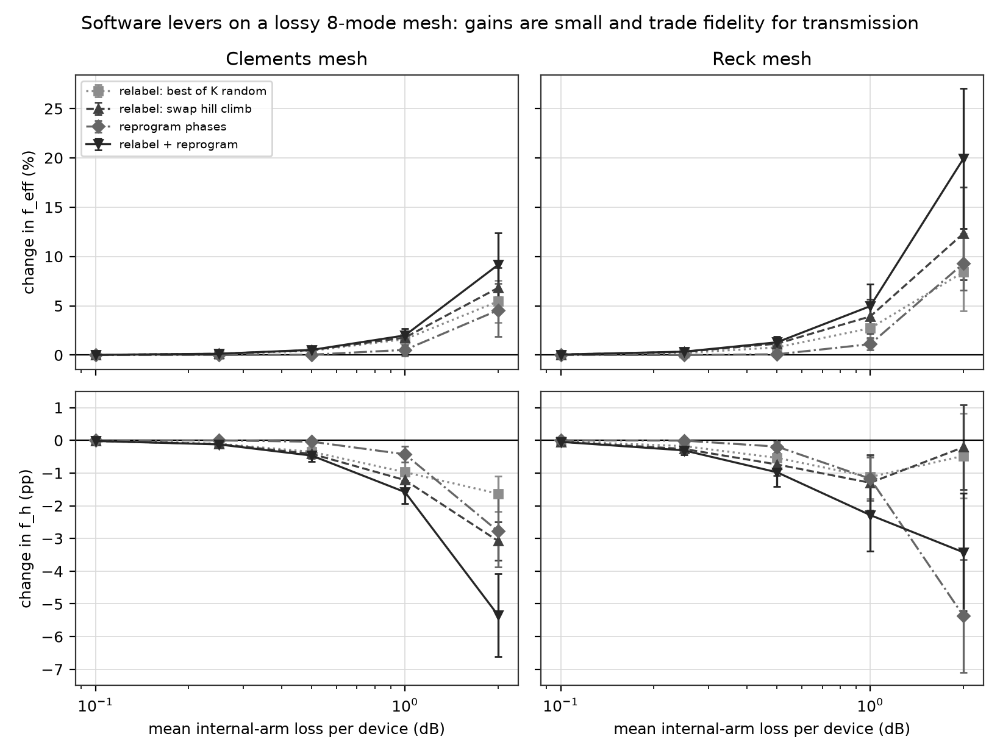
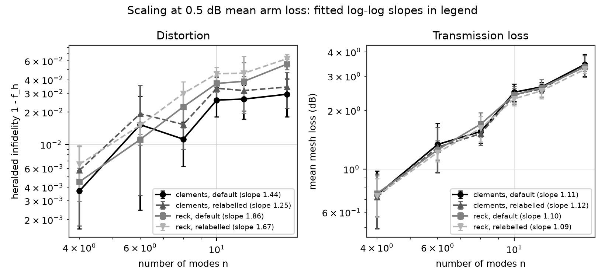
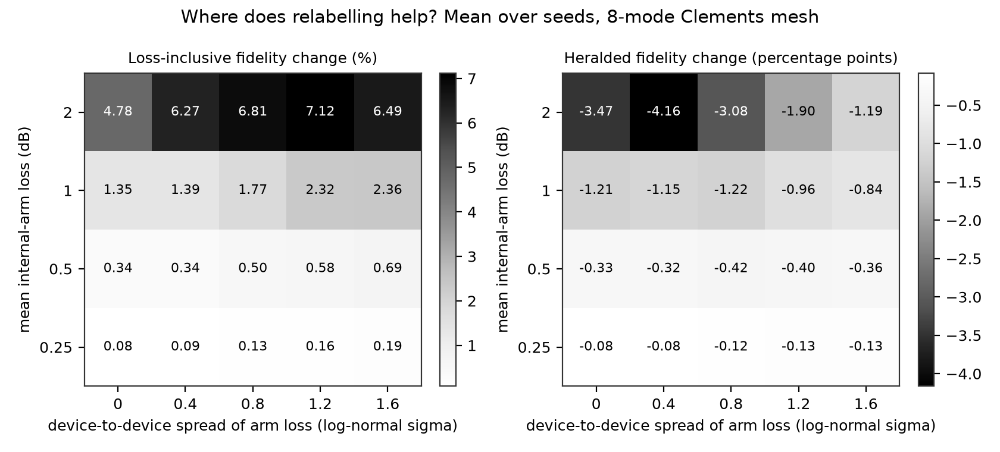
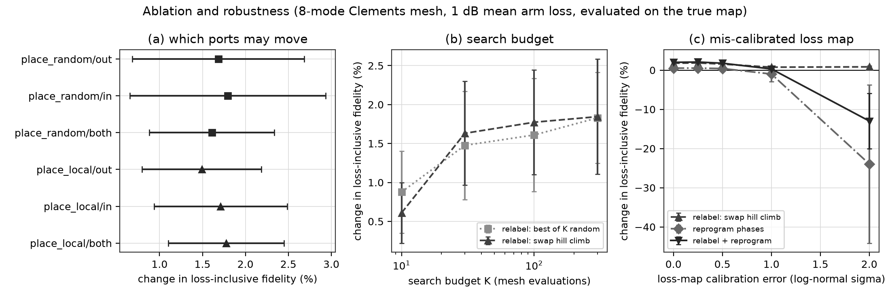
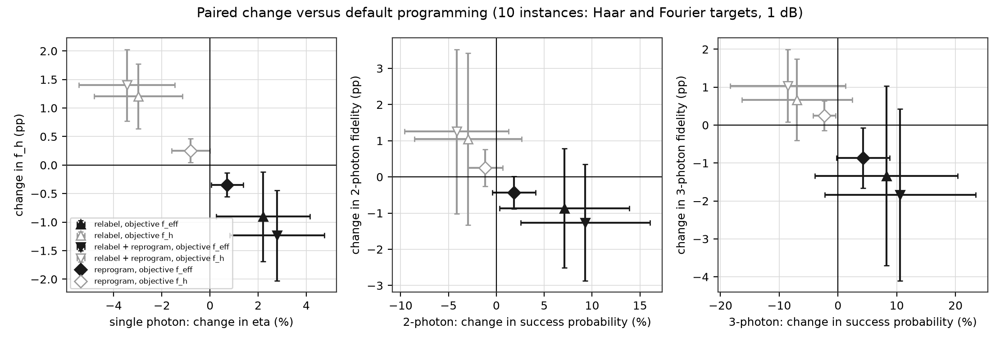

# Relabel or reprogram? What software can recover on a lossy photonic Mach-Zehnder-interferometer mesh



[](https://github.com/pradeepdegalaroyal/lossy-mzi-mesh-relabelling-vs-reprogramming/actions/workflows/ci.yml)

(CI: continuous integration. MZI: Mach-Zehnder interferometer. All numbers below come from files in `results/`; pp: percentage points.)

## TL;DR

Simulation study, 8-mode Clements mesh, 1 dB mean loss in the internal phase-shifter arm of each Mach-Zehnder interferometer (MZI), log-normal device spread 0.8, Haar-random targets, 5 seeds.
Changes are paired with default programming on the same unitary and loss map (mean ± standard deviation over seeds; source `results/loss_sweep.csv`, `results/key_numbers.json`).

| Strategy | Loss-inclusive fidelity f_eff | Mean transmission eta | Heralded fidelity f_h | Change in f_eff vs default | Change in f_h vs default |
|---|---|---|---|---|---|
| Default (loss-blind decomposition) | 0.4890 ± 0.0448 | 0.5092 ± 0.0402 | 0.9596 ± 0.0159 | – | – |
| Relabel ports, best of K = 100 random | 0.4967 ± 0.0440 | 0.5226 ± 0.0395 | 0.9498 ± 0.0179 | +1.61 ± 0.73 % | −0.97 ± 0.30 pp |
| Relabel ports, swap hill climb, K = 100 | 0.4975 ± 0.0440 | 0.5248 ± 0.0396 | 0.9474 ± 0.0185 | +1.77 ± 0.67 % | −1.22 ± 0.29 pp |
| Reprogram all phases (Adam) | 0.4915 ± 0.0443 | 0.5141 ± 0.0399 | 0.9553 ± 0.0176 | +0.52 ± 0.60 % | −0.43 ± 0.25 pp |
| Relabel + reprogram | 0.4986 ± 0.0437 | 0.5279 ± 0.0391 | 0.9438 ± 0.0191 | +1.99 ± 0.71 % | −1.58 ± 0.36 pp |

**Headline.** At 1 dB per device about half of the light is lost whatever the software does; relabelling the ports recovers about 1.8 % relative of the loss-inclusive fidelity, reprogramming about 0.5 %, and both together about 2 %.
The gain is bought with transmission, not with fidelity: heralded fidelity drops by 0.4 to 1.6 pp. The gain rises to +6.8 % (relabel) and +9.2 % (both) at 2 dB, and stays small below 0.5 dB.



*Figure 1. Relative change of loss-inclusive fidelity (top) and absolute change of heralded fidelity (bottom) against the default programming: all levers help the first and hurt the second, and only matter above about 0.5 dB.*

## Abstract

I simulate Reck and Clements meshes of Mach-Zehnder interferometers whose internal phase-shifter arms have a measured, device-to-device varying loss, so that each device transmits differently depending on the phase it is programmed to.
Two software levers are compared against standard loss-blind programming on the same lossy hardware: relabelling the input and output ports using the calibrated loss map, and gradient re-optimisation of all phases.
Both recover only a few percent of loss-inclusive fidelity (+1.8 % and +0.5 % at 1 dB, 8 modes), they trade heralded fidelity for transmission, relabelling survives a badly calibrated loss map, and re-optimisation does not.

## Method at a glance

```mermaid
%%{init: {'theme': 'base', 'themeVariables': {'primaryColor': '#ffffff', 'primaryTextColor': '#000000', 'primaryBorderColor': '#000000', 'lineColor': '#000000', 'secondaryColor': '#ffffff', 'tertiaryColor': '#ffffff', 'background': '#ffffff', 'noteBkgColor': '#ffffff', 'noteTextColor': '#000000', 'actorBkg': '#ffffff', 'actorBorder': '#000000', 'actorTextColor': '#000000', 'signalColor': '#000000', 'signalTextColor': '#000000', 'labelBoxBkgColor': '#ffffff', 'labelTextColor': '#000000', 'clusterBkg': '#ffffff', 'clusterBorder': '#000000'}}}%%
flowchart LR
  subgraph HW["Hardware lane: the true lossy mesh"]
    H1["losses.py: log-normal arm loss<br/>per device, mean 0.1 to 2 dB"]
    H2["mesh.py: Mach-Zehnder interferometer<br/>with lossy internal arm"]
    H3["losses.py: calibration error<br/>sigma_cal 0 to 2"]
  end
  subgraph SW["Programming lane: what software may change"]
    S1["place.py: relabel ports,<br/>random or swap hill climb, K evaluations"]
    S2["mesh.py: Clements or Reck<br/>exact decomposition"]
    S3["retune.py: Adam on all phases<br/>in PyTorch, 200 steps"]
  end
  E["metrics.py: evaluate on the TRUE map<br/>f_eff, eta, f_h, 2 and 3 photon statistics"]
  H1 --> H2
  H1 --> H3
  S1 --> S2
  S2 --> S3
  H2 --> E
  H3 --> S1
  S3 --> E
  classDef bw fill:#ffffff,stroke:#000000,color:#000000,stroke-width:2px;
  class H1,H2,H3,S1,S2,S3,E bw;
```

*The programming lane only sees the calibrated copy of the loss map (box H3); the evaluation box always uses the true map. f_eff: loss-inclusive fidelity; eta: mean transmission; f_h = f_eff / eta: heralded fidelity.*

**Model.** An MZI is two 50:50 couplers around an internal phase-shifter arm with amplitude transmission a. With a = 1 it equals the textbook T(theta, phi) exactly (tested); with a < 1 its transmission depends on the programmed theta. Both layouts are decomposed exactly (error below 1e-10).
**Metrics.** For target U and realised matrix T: f_eff = |tr(U†T)|²/n², eta = tr(T†T)/n, f_h = f_eff/eta; for N = 2 and 3 ideal indistinguishable photons, collision-free output statistics from permanents (success ratio to ideal, squared Bhattacharyya overlap).
**Baselines.** Standard photonic baseline: default Clements programming (and the older Reck layout). Classical search baseline: best of K random relabellings at the same budget K = 100 as the hill climb. Details in `docs/METHOD.md`.

## What is new here

* Loss is modelled **per device and phase-dependent** (internal arm), and the programming step receives the calibrated map, instead of treating loss as one scalar per layout.
* Two free software levers, **port relabelling** and **phase re-optimisation**, are measured against the same lossy hardware, with an equal-budget random-search control.
* The study reports the **transmission versus fidelity trade-off** that a loss-inclusive objective hides, down to two- and three-photon statistics, plus robustness to a wrong loss map.

## Motivation and research gap

Mesh layouts are usually ranked by depth and by robustness to uniform loss (Clements et al., 2016, doi:10.1364/OPTICA.3.001460). Roadmaps and reviews name loss as the bottleneck of integrated quantum photonics (Pelucchi et al., 2022, doi:10.1038/s42254-021-00398-z; Nusyura et al., 2026, doi:10.1007/s42484-026-00402-8), and system-level work now maps device loss to throughput and latency (Yousif et al., 2027, doi:10.1007/978-3-032-39708-9_27) or exploits two-photon interference as a computational resource (Di Bartolo et al., 2026, doi:10.1038/s41534-026-01236-9).
What the supplied abstracts do not report is how much of a fabricated mesh's loss penalty software can still remove once the per-device loss map is known. The full related-work table, hypotheses and success metric are in `docs/RESEARCH_GAP.md`.

## Results

### Hypotheses (fixed in `docs/RESEARCH_GAP.md` after one debugging instance, before the sweep)

| Hypothesis | Outcome | Evidence |
|---|---|---|
| H1: swap hill climb with K = 100 raises f_eff of the 8-mode Clements mesh by at least 1 % at 1 dB and beats equal-budget random relabelling | **First half confirmed, second half not established.** | +1.77 ± 0.67 % versus a 1 % threshold. Paired advantage over random relabelling is +0.16 ± 0.25 % at 1 dB and +1.31 ± 1.39 % at 2 dB (5 seeds), which is within noise |
| H2: re-optimising phases recovers more than relabelling | **Rejected.** | Reprogram +0.52 ± 0.60 % versus relabel +1.77 % at 1 dB; +4.55 ± 2.69 % versus +6.82 ± 2.02 % at 2 dB. Combining both is best (+1.99 %, +9.15 ± 3.23 %) |
| H3: the f_eff gain carries over to heralded three-photon fidelity | **Rejected.** | Relabelling changes the three-photon heralded fidelity by −1.5 ± 2.4 pp (Haar) and −1.2 ± 2.7 pp (Fourier targets), while the three-photon success probability rises +8.0 ± 14.0 % (Haar), i.e. not significantly |

### Loss sweep and layouts (Figure 1)

For the Reck layout the levers are larger: at 1 dB relabelling gives +3.91 ± 1.71 %, relabel + reprogram +4.96 ± 2.26 %; at 2 dB +12.33 ± 4.68 % and +19.91 ± 7.10 %. Reck starts lower, though: default f_eff at 1 dB is 0.4585 ± 0.0492 against 0.4890 ± 0.0448 for Clements, and its heralded fidelity is 0.9269 ± 0.0199 against 0.9596 ± 0.0159. Software does not close that gap at 1 dB (best Reck f_eff 0.4811 ± 0.0518).
At 0.1 dB nothing matters: relabelling changes f_eff by +0.021 ± 0.010 %.

### Scaling with mesh size (Figure 2)



*Figure 2. Log-log scaling at 0.5 dB: heralded infidelity grows roughly as n^1.4 (Clements) and n^1.9 (Reck); mesh loss in dB grows as n^1.1 for both layouts.*

Fitted slopes (`results/scaling_slopes.json`): heralded infidelity 1.44 (Clements default), 1.25 (Clements relabelled), 1.86 (Reck default), 1.67 (Reck relabelled); mesh loss in dB 1.11, 1.12, 1.10, 1.09. Error bars overlap strongly between 4 and 8 modes (5 seeds), so the slopes carry an uncertainty I did not estimate; the ordering Clements < Reck is the robust part. Relabelling does not change the loss scaling and slightly raises distortion, in line with Figure 1.

### Where relabelling helps (Figure 3)



*Figure 3. The gain is driven by the mean loss level, not by the device-to-device spread: even with identical devices (sigma = 0) relabelling gives +4.78 % at 2 dB.*

At 2 dB the f_eff gain is 4.78, 6.27, 6.81, 7.12 and 6.49 % for sigma = 0, 0.4, 0.8, 1.2, 1.6; at 1 dB it is 1.35 to 2.36 %. The mechanism is therefore the phase-dependent arm loss (a relabelling changes which arm the light uses), not the exploitation of a low-loss region. Heralded fidelity drops by up to 4.16 pp at 2 dB.

### Ablation and robustness (Figure 4)



*Figure 4. (a) Moving only inputs, only outputs or both gives the same gain within error bars; (b) the gain saturates near K = 30 evaluations; (c) relabelling survives a loss-map error of sigma_cal = 2, phase re-optimisation does not.*

Mean f_eff at 1 dB (default 0.4890): hill climb 0.4975 (both sides), 0.4973 (inputs only), 0.4963 (outputs only); random 0.4967, 0.4975, 0.4971; budget K = 10, 30, 100, 300 gives 0.4920, 0.4968, 0.4975, 0.4979 (hill climb) and 0.4932, 0.4962, 0.4967, 0.4979 (random). With a calibration error of sigma_cal = 2 the change relative to default is +0.84 ± 0.21 % for relabelling, −23.94 ± 20.19 % for reprogramming alone and −12.98 ± 7.08 % for both. A reprogramming step that overfits a wrong loss map is worse than doing nothing (already −0.98 ± 1.97 % at sigma_cal = 1).

### Transmission versus fidelity (Figure 5)



*Figure 5. Optimising f_eff (black) buys transmission and costs fidelity; optimising f_h (grey, open) does the opposite, and the three-photon statistics follow the same direction with larger error bars.*

Optimising f_h instead of f_eff with the relabelling search gives +0.9 pp single-photon heralded fidelity and +0.6 ± 1.1 pp three-photon fidelity (Haar), with −1.9 % transmission (`results/key_numbers.json`, `results/multiphoton_summary.csv`).

## Discussion (including negative results)

* The software levers are second-order. At 1 dB, 8 modes, the mesh transmits about half of the light and the best strategy changes f_eff by about 2 %. Reducing hardware loss per device (for example with low-loss thin-film lithium niobate modulators, Wang et al., 2018, doi:10.1038/s41586-018-0551-y) dominates.
* I did not find a free lunch: every gain in f_eff came with lower heralded fidelity at the same time, so whether relabelling is worth it depends on whether the downstream architecture pays more for lost photons (heralded, retried) or for distorted ones.
* The hill climb is not clearly better than random relabelling with the same budget at these sizes (paired +0.16 ± 0.25 % at 1 dB). The landscape over permutations is flat; the gain is a draw from a narrow distribution.
* Phase re-optimisation, the intuitively stronger lever, is the weakest below 2 dB and the most fragile when the loss map is wrong.

## Limitations

* Classical simulation of 4 to 16 modes and at most three ideal indistinguishable photons; no source impurity, no distinguishability, no detector inefficiency, no beam-splitter error, no phase noise.
* The loss model is a single internal arm per device with a log-normal spread. Real devices also have coupler imbalance and crosstalk that I did not model. A pure phase-independent loss gives no software lever at all (an early pilot with such a model, not saved in `results/`, showed no relabelling effect), so the conclusions depend on the phase-dependent arm loss being present.
* Relabelling assumes interchangeable sources and detectors.
* Five seeds, one pair of random unitary and loss map per seed; the error bars are wide and the scaling slopes are rough. The hypothesis thresholds were fixed after one debugging instance that is also seed 0 of the study.
* Retuning is a local optimiser from the default phases (200 steps); a global search could do better.

## Future work

On a real device the loss map would come from a calibration routine, and the relabelling freedom could be extended to choosing which physical ports host a subcircuit (partitioning a large mesh among circuits). The test I would run first is whether the preferred relabelling is stable across thermal cycles, because Figure 4(c) shows it tolerates large calibration errors. Extending the objective to fusion- or boson-sampling-style figures of merit with source and detector loss budgets would connect this to full-architecture loss budgets.

## Reproducibility

```bash
pip install -r requirements.txt && pip install -e .
pytest -q                               # 16 tests, about 15 s
python experiments/run_all.py --quick   # smoke run, about 1 minute
python experiments/run_all.py           # full study, 732 s (results/run_meta.json)
```

Hardware: Windows 11 laptop, central processing unit (CPU) only, 6 PyTorch threads, Python 3.11.9, numpy 2.2.6, torch 2.11.0. Seeds 0 to 4 (unitary: 1000 + seed, loss map: 2000 + seed). Raw results are comma-separated value (CSV) files in `results/`; `results/run_log.txt` is the console log of the full run.

## Project structure

```
src/meshplace/   mesh.py (decompositions, lossy MZI)  losses.py  metrics.py  place.py  retune.py  study.py
experiments/     run_all.py (all experiments)  make_figures.py (tables, figures, key numbers)
tests/           test_meshplace.py
docs/            RESEARCH_GAP.md  METHOD.md
results/ figures/   outputs of the full run
```

## Related work by the author

* [photonic-mesh-characterisation-photon-budget](https://github.com/pradeepdegalaroyal/photonic-mesh-characterisation-photon-budget): how to characterise beamsplitter errors of an MZI mesh at equal photon budget; this project asks what to do about loss once the mesh is characterised.
* [loss-optimal-switch-tree-photon-multiplexer](https://github.com/pradeepdegalaroyal/loss-optimal-switch-tree-photon-multiplexer): exact dynamic program for a loss-optimal switch tree of a photon-source multiplexer.

## License

MIT (Massachusetts Institute of Technology) license, see `LICENSE`.

## Citation

```bibtex
@software{degala_lossy_mzi_mesh_2026,
  author   = {Degala, Chenchupradeep},
  title    = {Relabel or reprogram? What software can recover on a lossy photonic Mach-Zehnder-interferometer mesh},
  year     = {2026},
  version  = {0.1.0},
  url      = {https://github.com/pradeepdegalaroyal/lossy-mzi-mesh-relabelling-vs-reprogramming},
  license  = {MIT}
}
```

MIT license (`LICENSE`). Machine-readable metadata is in `CITATION.cff`.
